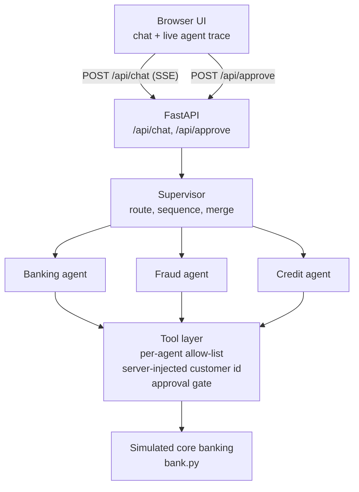

# Meridian Bank - Multi-Agent Banking Console

A simulated retail bank with a supervisor agent and three specialist agents (Banking, Fraud and Credit) behind a chat console. The language model proposes actions, but code enforces the permissions, screens the risk and requires a person to approve every transfer.

## Quick start

Windows (PowerShell):

```powershell
python -m venv .venv
.venv\Scripts\activate
pip install -r requirements.txt
copy .env.example .env
python app.py
```

macOS / Linux:

```bash
python3 -m venv .venv
source .venv/bin/activate
pip install -r requirements.txt
cp .env.example .env
python app.py
```

Open http://127.0.0.1:8000.

The LLM key is optional. To use the model, put a free Groq key from https://console.groq.com/keys on the `GROQ_API_KEY=` line in `.env`. Without a key the app runs on a rule-based fallback, and the header shows "Rule-based mode (no API key)". Git ignores `.env`.

### Run the checks

```bash
python test_bank.py
python test_agents.py
```

Each script prints `ok` when every check passes. A failed check stops the script with a traceback. Neither script needs a key. `test_agents.py` forces the rule-based brain.

### Key in GitHub secrets

The app reads `GROQ_API_KEY` from the environment, so the key never has to be in a file.

- **GitHub Actions:** add a repository secret named `GROQ_API_KEY` (Settings, Secrets and variables, Actions). The `checks` workflow runs both check scripts on every push, then `test_llm.py`, which sends three real requests through the LLM brain. Without the secret that step prints `skipped`. To use a different model, add a repository variable `LLM_MODEL`.
- **Codespaces:** add a Codespaces secret with the same name. It is injected as an environment variable, so `python app.py` starts in LLM mode with no `.env`.

A GitHub secret is only visible to Actions and Codespaces. A local clone still needs `.env` or an exported variable.

## Use cases to try

Select the customer in the header dropdown first. The agents in the table are the ones the rule-based brain runs. With a key, the model chooses the agents, so the routing can differ.

| Prompt | Customer | Agents run | What to look for |
|---|---|---|---|
| What's my balance and my last 5 transactions? | C001 | Banking | The ACC1001 balance and the five newest transactions. |
| Do any of my recent transactions look suspicious? | C002 (Arjun) | Fraud | TXN2007 and TXN2008 are flagged high. Both are online card payments from Lagos at 3 am. |
| Do any of my recent transactions look suspicious? | C001 | Fraud | Nothing is flagged. |
| Am I eligible for a 5 lakh personal loan over 3 years? | C001 | Credit | Approved at 10.5%. EMI is about 16,251. |
| Am I eligible for a 5 lakh personal loan over 3 years? | C003 | Credit | Declined. The score is 580, KYC is pending, DTI after the loan is above 55%, and there are 3 missed payments. |
| Transfer 5000 from ACC1001 to ACC2001 | C001 | Fraud, Banking | Fraud scores the transfer low. Banking requests it and an approval card appears. The balance changes only after Approve. Reject leaves it unchanged. |
| Send 2 lakh from ACC1001 to ACC9999 | C001 | Fraud, Banking | Fraud scores it high: over half the balance, 1,00,000 or more, and an unknown payee. The transfer is blocked. No approval card appears. |
| Block my credit card, I think it was used fraudulently | C001 | Fraud, Banking | Fraud reviews recent transactions. Banking blocks CARD101, the only card for C001. |

## Architecture



`/api/approve` calls `agents.approve`, which calls `bank.execute_transfer` directly. It is not a model tool and does not pass the allow-list.

| File | Lines | Responsibility |
|---|---|---|
| `app.py` | 73 | FastAPI app. Routes `/`, `/api/health`, `/api/customers`, `/api/chat` (SSE) and `/api/approve`. Validates requests with pydantic. |
| `agents.py` | 463 | Supervisor, specialist agents, tool registry, allow-lists, approval store, LLM brain, rule-based brain and the pipeline. |
| `bank.py` | 315 | Simulated core banking: seed data, transaction scoring, transfer screening, transfer execution and loan eligibility. |
| `static/index.html` | 329 | Single page: customer picker, chat, live agent trace and the approval card. |
| `test_agents.py` | 85 | Nine end-to-end checks of the use cases on the rule-based brain. |
| `test_bank.py` | 53 | Eight checks of the rules and balances in `bank.py`. |
| `requirements.txt` | 3 | Direct dependencies: fastapi, uvicorn, openai. |
| `.env.example` | 7 | Template for `.env`: `GROQ_API_KEY`, plus commented `LLM_MODEL` and `LLM_BASE_URL` overrides. |
| `.gitignore` | 3 | Ignores `.env`, `.venv/` and `__pycache__/`. |

## How a request flows

1. The browser posts `customer_id`, `message` and up to 20 earlier turns to `/api/chat`. An unknown customer gets HTTP 404.
2. `agents.run` picks a brain. If `GROQ_API_KEY` or `LLM_API_KEY` is set, the LLM brain runs. Otherwise the rule-based brain runs.
3. The supervisor returns an ordered plan of (agent, task) pairs and emits `route`. The LLM brain asks the model for the plan as JSON. The rule-based brain uses keyword patterns. An empty plan ends the request with `answer`.
4. Agents run in plan order. Each one emits `agent_start` and `agent_done`. In the LLM brain, each agent's prompt includes the findings of the agents before it. In the rule-based brain, each agent runs a fixed tool sequence and does not see earlier findings.
5. An LLM agent runs at most 5 model calls (`range(5)` in `_agent_llm`). Each tool call the model requests goes through `_run_tool`, and its result goes back to the model. If the limit is reached without a final answer, the agent returns "I could not finish this task within the step limit."
6. `_run_tool` emits `tool_call` and then `tool_result`. If the result holds an `approval_id`, it also emits `approval` with the transfer arguments and the risk screen.
7. With one finding, that agent's text is the answer. With several, the LLM brain makes one more model call without tools to merge them (`_synthesise`). The rule-based brain joins them under bold agent labels.
8. The events reach the browser as SSE `data:` lines: `route`, `agent_start`, `tool_call`, `tool_result`, `approval`, `agent_done`, `answer`, `error`, and finally `done`, which app.py adds.
9. Failures: if the LLM raises before any tool ran, `run` emits `error` and reruns the rule-based brain. If it raises after a tool ran, `run` emits `error` and stops. app.py turns any other exception into an `error` event.

## Design decisions

- **The LLM proposes, code decides.** `request_transfer` never moves money. It screens the transfer, stores it in `PENDING` and returns `pending_approval`. Only `/api/approve` calls `bank.execute_transfer`. It removes the approval from `PENDING` before it acts, so each approval works once. A transfer with risk `high` is returned as `blocked` and is never stored. The model cannot change that result.
- **`customer_id` is not a tool parameter.** The tool schemas sent to the model leave it out. `_run_tool` passes the customer id from the request. Extra arguments the model adds are dropped in `_agent_llm`. A prompt therefore cannot pick another customer. This does not stop a client from sending another customer's id, because there is no login. See Limitations.
- **Each agent has an allow-list.** `AGENTS` lists each agent's tools. `_run_tool` checks the list before it calls anything. The Credit agent has no `block_card`. If the model asks for it, the model gets an error result and the card stays active. `test_tools_are_scoped_per_agent` checks this.
- **Two brains, one pipeline.** Both brains emit the same events and call the same tools. The rule-based brain needs no key, and its fixed sequences make the tests repeatable. It is the fallback when the LLM fails before any tool ran. After a tool has run, `run` stops instead of replaying, because a replay could repeat a side effect such as a transfer request.
- **Fraud and loan decisions are rules in `bank.py`.** The LLM only explains them.
  - Transaction score (`score_transaction`): home city differs +40; amount over 3 times the customer's median debit +25; time between 00:00 and 05:59 +20; online card payment to a merchant the customer has not used before +15. The total is capped at 100.
  - Transfer score (`screen_transfer`): over half of total balance +45; 1,00,000 or more +30; payee not a known beneficiary +25; KYC not verified +20.
  - Levels: 60 or more is high, 30 to 59 is medium, below 30 is low. A high transfer is blocked.
  - Loan rate from credit score: 750 or more 10.5%; 700 to 749 12%; 650 to 699 14.5%; below 650 18%.
  - Loan decision: declined if the score is below 600, DTI after the loan is above 55%, or KYC is not verified. Refer if the score is below 700, DTI is above 40%, or there is a missed payment in the last 12 months. Otherwise approved. DTI is (existing EMIs + new EMI) / monthly income.
- **Provider-agnostic.** The LLM client is the OpenAI SDK. `LLM_BASE_URL` defaults to Groq and `LLM_MODEL` defaults to `llama-3.3-70b-versatile`. Any OpenAI-compatible endpoint should work by changing those two values. This project is only set up for the Groq default.
- **Small on purpose.** Three direct dependencies, no agent framework and no build step. The orchestration logic is in one file, `agents.py`, so a reader can follow a request from start to finish.

## Mapping to the reference architecture

| Reference layer | This MVP | Not implemented |
|---|---|---|
| Channels | Web UI only | Other channels |
| API layer | FastAPI routes, pydantic request validation | Authentication, rate limiting |
| AI control plane | Model chosen by env vars. Guardrails as code (risk gate, allow-lists). Human approval for transfers. | PII detection, token budgets |
| Multi-agent orchestrator | Supervisor plus 3 specialist agents | The other agents in the reference design |
| Tool layer | Tool registry with schemas, per-agent allow-list, transfer approval gate | MCP gateway, sandbox |
| Enterprise data | In-memory seed data in `bank.py` | Database, real systems of record |
| Knowledge / RAG | Not implemented | Retrieval over policy documents |
| External services | Simulated credit bureau (`get_credit_report`) | Real bureau, payment rails |
| Cross-cutting | Live agent trace in the UI | Persistence, audit log |

## Limitations and next steps

- State is in memory and runs in one process. A restart resets balances, cards, loans and pending approvals.
- There is no authentication. The customer is chosen from a dropdown and sent in the request body. Anyone who can reach the server can act for any customer.
- The rule-based fallback understands only the phrasings its patterns cover. Other phrasings get the help text or the wrong agent.
- The pending-approval store has no expiry. An approval stays open until someone acts on it.
- The LLM path depends on the model returning valid JSON and well-formed tool calls. Bad output triggers the fallback or an error event.
- The LLM path is covered only by `test_llm.py`, a live smoke test that needs a key and checks routing and tool use, not answer quality. `test_agents.py` forces the rule-based brain.
- `loan_type` is accepted by the eligibility check and ignored.
- There is no retrieval over policy documents, so the agents cannot quote bank policy.

Next steps:

- Persistence and an audit log for every tool call and approval.
- Authentication and server-side sessions, so the customer id comes from the login.
- A compliance agent with retrieval over policy documents.
- An evaluation set for routing accuracy, run against both brains.
